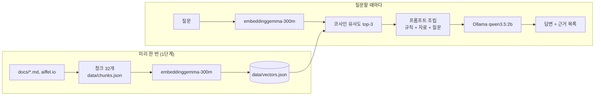

# 아이펠 생활 안내 챗봇 (로컬 RAG)

아이펠 AI 에이전트 과정의 운영·생활 규정(출결, 공가, 훈련장려금, 수료 등)을 묻는 질문에, 흩어진 공지와 규정을 모은 자료에서 근거를 찾아 출처와 함께 답하는 챗봇입니다. 내 PC에서만 돌아가는 Node.js 프로그램이며, PowerShell에서 실행합니다.

작성: Sung, Hyun-Joon · 모두의연구소 아이펠 AI 에이전트 2기 프롬프트 엔지니어링 5. 나만의 챗봇 서비스 만들기

## 1. 소개

**누구를 위한 것인가**: 아이펠 지원 예정자, 신입·기존 수강생, 운영진. 규정이 노션 공지, 온보딩 강의, 홈페이지에 흩어져 있어 어디서 찾아야 할지 모르는 사람.

**답하는 것**: 출결 시간과 지각·조퇴·결석 기준, 공가·휴가, 훈련장려금, 수강 중 아르바이트, 수료·졸업, 제적·경고, 퀘스트, 질문하는 방법 등 규정 내용.

**답하지 않는 것**
- 개인 출결·장려금 현황, "제 경우 수료 가능한가요?" 같은 개인 판정 → "개인정보 관련사항에 대해서는 HRD-Net 출결 앱 또는 담당 운영 매니저에게 확인 바랍니다."
- 자료에 없는 질문 → "해당 문의사항은 본 서비스를 통해 답변이 불가능합니다. 담당 퍼실리테이터 또는 매니저에게 문의 바랍니다."
- 자료를 만든 시점(2026-10-13) 이후 바뀐 공지. 최신 내용은 노션 공지가 우선입니다.

## 2. 동작 원리



1. 자료를 사실 하나씩 담은 청크(120자 이상)로 자르고, 청크마다 출처(url, section)를 붙인다.
2. 청크를 임베딩 모델로 숫자 768개(벡터)로 바꿔 벡터 저장소에 저장한다. 뜻이 비슷한 문장은 가까운 벡터가 된다.
3. 질문도 같은 모델로 벡터로 바꾸고, 모든 청크와 코사인 유사도를 계산해 가장 가까운 3개를 고른다(1단계, 검색).
4. 고른 청크와 질문을 "이 자료 안에서만 답하고 근거 ID를 달라"는 규칙과 함께 LLM에 보낸다(2단계, 생성).
5. 답변 뒤에는 LLM에게 넘긴 자료를 프로그램이 직접 목록으로 보여 준다. 작은 LLM은 근거 ID를 빼먹거나 틀리게 적기 때문이다.

## 3. 사용 기술

| 역할 | 기술 | 설정 |
|---|---|---|
| 임베딩 | transformers.js (`@huggingface/transformers`) + `onnx-community/embeddinggemma-300m-ONNX` | q8, 768차원, mean pooling + 정규화, 모델 카드 공식 입력 형식(문서 `title: 섹션 \| text: 본문`, 질문 `task: search result \| query: 질문`) |
| 검색 | 코사인 유사도(정규화 벡터의 내적) | top-3, 1위 점수 0.55 미만이면 "관련 자료가 약함" |
| 생성 | Ollama `qwen3.5:2b` | stream, think: false, temperature 0 |
| 설계 계약 | `CLAUDE.md` | 데이터·임베딩·검색·생성 계약을 단계마다 기록 |

## 4. 실행 방법 (Windows PowerShell)

준비: Node.js 20 이상, [Ollama](https://ollama.com) 설치 후

```powershell
ollama pull qwen3.5:2b
npm install
```

벡터 저장소 만들기 (청크를 고친 뒤에도 다시 실행해야 검색에 반영된다. 첫 실행은 모델 약 300MB 다운로드):

```powershell
node src/build-index.mjs
```

1단계, 검색만:

```powershell
node src/search.mjs "QR 몇 시까지 찍어야 지각 아니야?" "병원 가면 출석 인정돼?"
```

2단계, 답변까지:

```powershell
node src/ask.mjs "휴가 며칠 쓸 수 있어?"
```

| 옵션 | 뜻 |
|---|---|
| `--k 5` | 검색 결과 개수 (기본 3) |
| `--show-prompt` | LLM에게 보낼 시스템 메시지와 프롬프트를 출력만 하고 끝냄 (Ollama 없이 동작) |
| `--no-rag` | 검색·규칙 없이 질문만 LLM에 보냄 (비교 실험용) |
| `--model 이름` | 답변 모델 변경 (기본 `qwen3.5:2b`, 실험용) |

한글이 깨지면 먼저 `[Console]::OutputEncoding = [Text.Encoding]::UTF8`을 실행한다.

## 5. 자료

| 출처 | 파일 | 청크 |
|---|---|---|
| 아이펠 공식 홈페이지 AI 에이전트 트랙 (다음 기수 모집 기준) | https://aiffel.io/ai-agent | AF-001~005 |
| AI 에이전트 2기 노션 공지 정리 | `docs/cohort2.md` | AF-006~022, AF-032 |
| 아이펠 온보딩 강의 정리 | `docs/rules.md` | AF-023~031 |

**청크 설계 원칙**
1. 한 청크에 사실 하나. 주제가 섞이면 검색이 흐려진다(6절 "카페" 사례).
2. 혼자 읽어도 뜻이 통하게. 주어를 살린다("그 기준은…" 금지).
3. 원문에 없는 말을 보태지 않는다. 개인 이름, 출결 기록, 신청 폼 주소는 넣지 않는다.

**출처끼리 다를 때**: 온보딩 강의와 2기 공지의 조퇴 기준(17:50 이전 vs 14:30~17:49), 외출 복귀 시각(17:50 vs 17:40)이 달랐다. 2기 공지를 우선하고 어긋나는 온보딩 청크는 자료에서 뺐다. 검색이 틀린 쪽을 고를 수 없게 하기 위해서다.

## 6. 1단계 관찰 기록

32청크, embeddinggemma-300m q8, top-3, 약한 근거 기준 0.55.

| 질문 | 유형 | 1위 청크 | 점수 | 관찰 |
|---|---|---|---|---|
| QR 몇 시까지 찍어야 지각 아니야? | 정상 | AF-008 QR 찍는 시간과 지각 조퇴 기준 | 0.752 | 정확히 찾음 |
| 병원 가면 출석 인정돼? | 다른 표현 | AF-013 질병 공가 기준 | 0.704 | "병원"이라는 단어가 없어도 질병·진료 청크를 찾음 |
| 늦게 들어오면 어떻게 돼? | 다른 표현 | AF-010 결석 기준 | 0.653 | 지각 기준(AF-008)은 2위. "늦게"가 14:30 이후 참여(결석)에도 끌림 |
| 알바해도 장려금 받을 수 있어? | 경계 | AF-026 훈련장려금 신고 대상 | 0.670 | 2위 AF-016 아르바이트 청크까지 있어야 완전한 답 |
| 우리 과정 언제 끝나? | 함정(시점) | AF-006 2기 과정 정보 | 0.615 | 다음 기수 모집 날짜(AF-001)가 아니라 2기 날짜를 찾음 |
| 내 출석률 몇 퍼센트야? | 도메인 밖(개인 정보) | AF-010 결석 기준 | 0.713 | 자료에 답이 없는데 기준(0.55)을 넘음 → 2단계 규칙으로 막아야 함 |
| 김치찌개 레시피 알려줘 | 무관 | AF-029 수업 참여 규칙 | 0.420 | ⚠ 약한 근거 경고 |

### 청크를 고쳐서 검색이 좋아진 사례

| 질문 | 고치기 전 | 고친 뒤 |
|---|---|---|
| 카페에서 QR 찍어도 돼? | 답이 든 AF-019 옐로카드가 5위(0.510), 1위는 QR 시간 청크 | AF-032 부정 출석으로 보는 경우 1위(0.613) |
| 집 말고 다른 장소에서 QR 찍어도 돼? | AF-019 4위(0.558) | AF-032 1위(0.665) |

원인: 경고 사유 4종류를 한 청크에 섞었고, 원문의 "카페 등"을 요약하다 뺐다.
해결: "부정 출석으로 보는 경우"를 별도 청크로 떼고 원문 예시(카페, 지하철·버스·택시, 대리출석)를 그대로 넣었다.
다만 1위와 2위 점수 차이(0.613 vs 0.595)가 작아서, 표현이 조금만 달라져도 순위가 바뀔 수 있다.

## 7. 2단계 비교 실험

### RAG가 있을 때와 없을 때 (qwen3.5:2b, temperature 0)

| 질문 | RAG 없이 | RAG | 지어낸 내용? |
|---|---|---|---|
| 아이펠 2기 휴가는 며칠 쓸 수 있어? | "10일, 1기+2기 합쳐 최대 20일" | 단위기간 내 1일, 전체 최대 6일, 사전 신청서 필수 [AF-014] | RAG 없이: 전부 지어냄 |
| 아이펠에서 카페에 가서 출석 QR 찍어도 돼? | "네, 스캔하면 출석이 완료됩니다" + 출석 카드·교사 등 무관한 이야기 | 아닙니다. 카페 등 승인되지 않은 장소는 부정 출석 사유 [AF-032] | RAG 없이: 정반대 답 |
| 아이펠 훈련장려금은 하루에 얼마야? | "영어 교육 기관, 초등학교 3학년 기준 15만 원" | 하루 15,800원 [AF-025] | RAG 없이: 아이펠을 영어 학원으로 착각 |

RAG 없이는 모델이 아이펠이 무엇인지도 모르고 숫자를 지어냈다. RAG를 붙이자 세 질문 모두 자료의 숫자로 답했다.

### 카페 오답 고치기: 한 번에 하나만 바꾸기

기준: "카페에서 QR 찍어도 돼?"에 qwen3.5:2b가 "카페에서 QR 찍어도 됩니다"라고 정반대로 답함.
검색 1위는 정답 청크(AF-032)였으므로 R(검색)이 아니라 G(생성) 단계의 실패.

| 실험 | 바꾼 것 | "카페에서 QR 찍어도 돼?" | "아이펠에서 카페에 가서 출석 QR 찍어도 돼?" | 답변 시간 |
|---|---|---|---|---|
| 기준 | — | ❌ 찍어도 됩니다 | ✅ 아닙니다 [AF-032] | 13~14초 |
| 실험 1 | 모델만 gemma4:e4b로 | ✅ 부정 출석, 경고 사유 [AF-032] | ✅ 같음 [AF-032] | 32~53초 |
| 실험 2 | AF-032 문장만 수정(긴 나열 → "~하면 부정 출석이다" 문장들) | ✅ 부정 출석이다 (AF-032) | ✅ 부정 출석이다, 단 ID는 [AF-008]로 잘못 표시 | 14~19초 |

- 실험 2는 검색 점수도 올렸다(0.613 → 0.666). 문장이 질문과 직접 맞닿게 바뀌었기 때문.
- 결정: **실험 2를 채택**하고 모델은 qwen3.5:2b 유지. 큰 모델은 정확했지만 답이 2~4배 느리다.
- 남은 문제: 작은 모델이 근거 ID를 틀리게 적기도 한다(내용은 AF-032인데 [AF-008] 표시). 그래서 📚 근거 목록의 ✓는 "답변에 그 ID가 적혔다"는 뜻일 뿐, 실제 근거가 맞는지는 사람이 원문과 대조해야 한다.
- 기준에서 짧은 질문만 틀리고 긴 질문은 맞았다. 작은 모델은 질문 표현에 따라 답이 흔들린다.

## 8. 한계와 다음 단계

- **2B 모델의 한계**: 정답 청크를 받고도 거꾸로 읽은 적이 있다(7절 카페 사례). 근거 ID를 빼먹거나 다른 ID를 적기도 한다. 답은 📚 근거의 원문과 대조해야 한다.
- **검색 점수만으로는 "답이 없음"을 판단할 수 없다**: "내 출석률 몇 퍼센트야?"는 자료에 답이 없는데 0.713점을 받았다. 이런 질문은 시스템 메시지의 규칙으로 막는다.
- **답에 여러 청크가 필요한 질문**: "알바해도 장려금 받을 수 있어?"는 두 청크(신고 대상, 아르바이트 기준)를 함께 읽어야 완전한 답이 된다.
- **자료의 시점**: 홈페이지는 다음 기수 모집 정보다. 공지가 바뀌면 `docs/`를 고치고 `node src/build-index.mjs`를 다시 실행해야 한다.
- **다음에 해 볼 것**: 단어 일치 검색 BM25를 섞은 하이브리드 검색, 시각 정보를 묻지 않았는데 답에 말하는 버릇 고치기, 질문 세트를 고정해 루브릭 점수로 비교하기.
